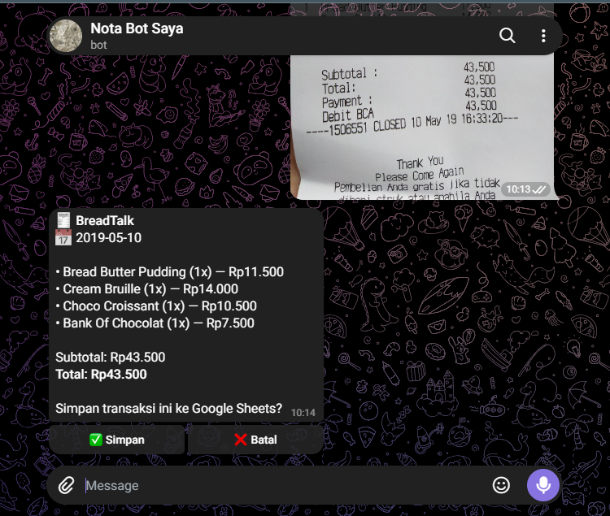
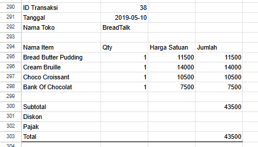
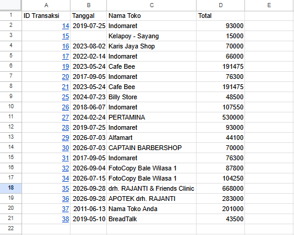

# Telegram Nota Bot

Bot Telegram pencatat struk belanja otomatis. Cukup kirim foto struk, bot membacanya dengan AI (Google Gemini), menampilkan ringkasan untuk dikonfirmasi, lalu menyimpannya ke database Supabase dan Google Sheets.

Tujuannya sederhana: tidak perlu lagi mencatat pengeluaran secara manual. Semua terjadi dalam satu percakapan Telegram, dan hasilnya langsung bisa dibuka sebagai spreadsheet.





## Cara Kerja

```
User kirim foto struk ke bot
        ↓
Bot ambil foto resolusi tertinggi → kirim ke Gemini (gemini-2.5-flash)
        ↓
Gemini mengembalikan data terstruktur (JSON): toko, tanggal, item, subtotal, diskon, pajak, total
        ↓
Transaksi disimpan ke Supabase dengan status "pending"
        ↓
Bot membalas ringkasan + tombol [✅ Simpan] / [❌ Batal]
        ↓
Simpan → ditulis ke Google Sheets, status jadi "confirmed"
Batal  → status jadi "cancelled" (tidak ditulis ke Sheets)
```

## Fitur

- **Ekstraksi struk berbasis AI.** Gemini membaca foto struk dan mengubahnya menjadi JSON terstruktur, bukan sekadar teks mentah. Prompt memaksa format JSON yang persis dan melarang model mengarang angka (misalnya pajak diisi `null` kalau tidak tertulis di struk).
- **Konfirmasi sebelum simpan.** Hasil ekstraksi ditampilkan dulu di chat, jadi data yang salah baca tidak langsung masuk ke spreadsheet.
- **Status transaksi.** Setiap transaksi punya status `pending` → `confirmed` / `cancelled` di Supabase. Supabase menjadi sumber data utama, Google Sheets sebagai tampilan.
- **Pencegahan simpan ganda.** Tombol yang ditekan dua kali tidak menulis data dua kali, karena hanya transaksi berstatus `pending` yang bisa diproses.
- **Penanganan error yang jelas.** Kalau foto tidak terbaca, bot meminta foto ulang. Kalau batas pemakaian AI tercapai (HTTP 429), bot memberi tahu untuk mencoba lagi 1–2 menit kemudian.
- **Pembersihan output AI.** Gemini kadang membungkus JSON dengan blok markdown walau sudah diminta tidak. Bungkus itu dibuang sebelum di-parse, dan field yang hilang dinormalisasi agar tidak membuat crash.
- **Google Sheets dengan dua tab:**
  - **Detail** (default `Sheet1`): satu blok per transaksi berisi info toko, rincian item (qty, harga satuan, jumlah), subtotal, diskon, pajak, dan total, dengan garis pemisah antar blok.
  - **Ringkasan**: satu baris per transaksi (ID, tanggal, toko, total). Kolom ID berupa hyperlink yang langsung melompat ke blok detailnya.
  - Tab dan header dibuat otomatis kalau belum ada.
- **Dua mode jalan.** Polling untuk development lokal (tanpa domain publik) dan webhook untuk production, dipilih otomatis dari ada/tidaknya `WEBHOOK_URL`.

## Tech Stack

| Layer | Teknologi |
|---|---|
| Runtime | Node.js 22 |
| Server | Express (endpoint webhook + health check) |
| Bot | Telegram Bot API (`node-telegram-bot-api`) |
| AI | Google Gemini `gemini-2.5-flash` (`@google/generative-ai`) |
| Database | Supabase (PostgreSQL) |
| Spreadsheet | Google Sheets API (`googleapis`, service account) |
| Deploy | Docker di Render |

## Struktur Project

```
telegram-nota-bot/
├── src/
│   ├── index.js                  → entry point: Express, mode webhook/polling, routing pesan
│   ├── ai/extractReceipt.js      → prompt + kirim gambar ke Gemini, parse & normalisasi JSON
│   ├── db/supabaseClient.js      → simpan transaksi pending, ambil, dan update status
│   ├── sheets/appendToSheet.js   → tulis blok detail + baris ringkasan ke Google Sheets
│   └── handlers/
│       ├── photoHandler.js       → saat foto struk diterima
│       └── callbackHandler.js    → saat tombol Simpan/Batal ditekan
├── Dockerfile
├── package.json
├── .env.example
└── .gitignore
```

## Environment Variables

| Variabel | Wajib | Keterangan |
|---|---|---|
| `TELEGRAM_BOT_TOKEN` | Ya | Token bot dari @BotFather |
| `GEMINI_API_KEY` | Ya | API key dari Google AI Studio |
| `SUPABASE_URL` | Ya | Supabase → Project Settings → API |
| `SUPABASE_KEY` | Ya | Service role key (hanya dipakai di server, jangan pernah dibagikan) |
| `GOOGLE_SERVICE_ACCOUNT_BASE64` | Ya | Seluruh isi file JSON service account Google, di-encode base64 |
| `SPREADSHEET_ID` | Ya | ID dari URL Google Sheets tujuan |
| `WEBHOOK_URL` | Production | URL publik service, tanpa garis miring di akhir. Kosongkan saat lokal agar bot memakai polling |
| `SHEET_NAME` | Tidak | Nama tab detail (default `Sheet1`) |
| `SUMMARY_SHEET_NAME` | Tidak | Nama tab ringkasan (default `Ringkasan`) |
| `PORT` | Tidak | Port server (default `8080`) |

Cara membuat `GOOGLE_SERVICE_ACCOUNT_BASE64` dari file JSON service account:

```bash
# macOS / Linux
base64 -w 0 service-account.json      # di macOS: base64 -i service-account.json
```

```powershell
# Windows PowerShell
[Convert]::ToBase64String([IO.File]::ReadAllBytes("service-account.json"))
```

## Setup

### 1. Supabase

Buat tabel `transactions` dengan kolom berikut (sesuaikan dengan schema yang dipakai):

| Kolom | Tipe |
|---|---|
| `id` | bigint, primary key, auto increment |
| `telegram_user_id` | text |
| `store_name` | text |
| `transaction_date` | date |
| `items` | jsonb |
| `subtotal`, `discount`, `tax`, `total` | numeric |
| `status` | text (`pending` / `confirmed` / `cancelled`) |
| `created_at` | timestamptz, default `now()` |

### 2. Google Sheets

1. Buat service account di Google Cloud dan aktifkan Google Sheets API.
2. Download file JSON kredensialnya, lalu ubah ke base64 (lihat di atas).
3. **Share spreadsheet tujuan ke email service account** (`client_email` di file JSON) dengan akses Editor. Tanpa ini, penyimpanan akan gagal dengan *permission denied*.

### 3. Jalankan lokal (mode polling)

```bash
npm install
cp .env.example .env     # isi semua variabel, kosongkan WEBHOOK_URL
npm start
```

Buka Telegram → chat bot → `/start` → kirim foto struk. Mode polling tidak butuh domain publik.

Alternatif dengan Docker:

```bash
docker build -t nota-bot .
docker run --env-file .env -p 8080:8080 nota-bot
```

## Deploy ke Render (Docker)

1. Push repo ke GitHub (pastikan `.env` tidak ikut ter-commit).
2. Render → **New → Web Service** → hubungkan repo → pilih runtime **Docker**. Render otomatis memakai `Dockerfile` di root repo.
3. Masukkan semua environment variable di tab **Environment**.
4. Setelah deploy pertama berhasil, isi `WEBHOOK_URL` dengan URL service, misalnya `https://telegram-nota-bot.onrender.com`, lalu deploy ulang. Bot otomatis mendaftarkan webhook ke Telegram saat start.
5. Cek log: harus muncul `Bot berjalan dalam mode WEBHOOK`.

Endpoint `GET /` dipakai sebagai health check.

## Catatan & Troubleshooting

- **Kualitas foto menentukan hasil.** Struk buram, miring, atau terpotong sering membuat Gemini gagal menghasilkan JSON yang valid. Bot akan meminta foto ulang.
- **Cold start Render free tier.** Service tidur setelah idle, jadi pesan pertama butuh beberapa detik untuk dibalas.
- **Bot diam total.** Biasanya token salah atau webhook lama masih terdaftar. Coba jalankan mode polling dulu (kosongkan `WEBHOOK_URL`) untuk mengisolasi masalah.
- **Error `relation "transactions" does not exist`.** Tabel belum dibuat di Supabase.

## Keterbatasan & Rencana Pengembangan

- **Belum ada fitur edit.** Kalau Gemini salah baca, saat ini hanya bisa Batal lalu foto ulang. Rencananya ada tombol edit untuk mengoreksi total atau nama toko langsung di chat.
- **Belum ada fitur hapus setelah disimpan.** Menghapus baris langsung di Google Sheets membuat data tidak sinkron dengan Supabase. Rencananya ada command `/batal <ID>` yang mengubah status menjadi `cancelled` di Supabase dan menandai baris di Sheets.
- **Transaksi `pending` yang tidak dikonfirmasi tidak dibersihkan.** Perlu job berkala untuk menghapus atau membatalkan transaksi pending yang sudah lama.
- **Validasi hasil AI.** Total yang tidak terbaca saat ini diisi 0. Lebih baik dicocokkan dengan jumlah harga item, atau diminta foto ulang. Gemini juga mendukung *structured output* (`responseMimeType` + `responseSchema`) yang bisa menggantikan pembersihan JSON manual.
- **Kategorisasi & rekap.** Klasifikasi otomatis (makanan, transport, belanja) dan command `/rekap` untuk ringkasan bulanan.
- **Multi-user.** Saat ini satu spreadsheet untuk semua pengguna. Bisa dikembangkan agar setiap `telegram_user_id` punya spreadsheet sendiri.
